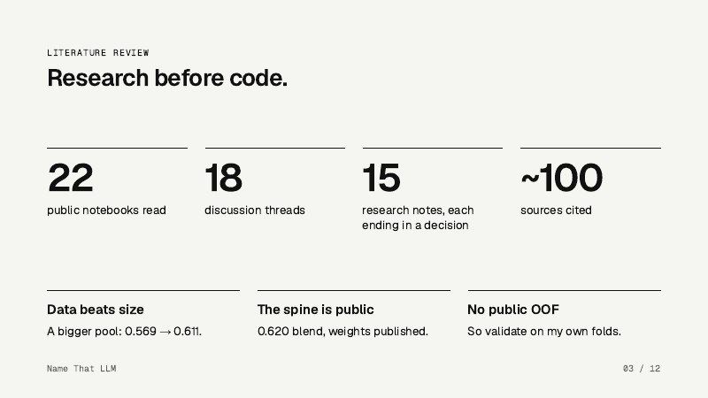
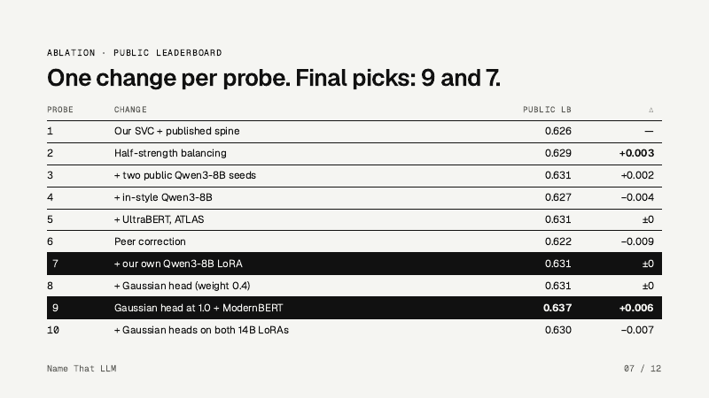

<div align="center">

# Name That LLM

**Which of 18 language models wrote this passage?**

[](LICENSE)
&nbsp;[](https://github.com/Nabzx/name-that-llm/actions/workflows/tests.yml)
&nbsp;[](https://www.kaggle.com/competitions/name-that-llm)
&nbsp;
&nbsp;

</div>

A solo entry to the Imperial Research Arm qualifier, run on Kaggle's [Name That LLM](https://www.kaggle.com/competitions/name-that-llm). Each passage is 40 to 250 words, written by one of 18 frontier models from OpenAI, Google, Anthropic, Qwen, Z.ai and Moonshot. Test prompts never appear in training, and the score is balanced accuracy. Best public score **0.637**.

**Hand-in:** [report (2 pages)](docs/report/report.pdf) · [slides](documents/presentation.pdf) · [speaker notes](documents/speaker-notes.pdf) · [experiment log](docs/experiments/LOG.md) · [AI sessions](ai-sessions)

<p align="center"></p>

## Method

1. **Research before code.** 22 public notebooks, 18 discussion threads and 15 research notes, each ending in a decision ([`docs/research/`](docs/research)).
2. **Validation first.** Five folds grouped by prompt, frozen in `src/nthl/folds.csv`, so no prompt is in both train and validation.
3. **More data.** A pool of 84,470 passages from 19 public, open-licence datasets took our n-gram SVC from 0.348 to 0.484 CV.
4. **Published checkpoints, our own loader.** LoRA classifiers other Kagglers published on Qwen, read by code we wrote, with checks on label order and end token.
5. **Our own LoRA.** A two-stage Qwen3-8B classifier trained on Kaggle overnight: 0.519 on unseen host train after stage 1.
6. **Shared-prompt Gaussian group head.** Our own code after prvsiyan's public method: test passages that share a prompt are decoded together with the prompt's effect removed. **+0.058** on its own view.
7. **Blend and balance.** A weighted sum of log probabilities, fixed shares for extra members, then half-strength Sinkhorn.

Every change is one row in [`docs/experiments/LOG.md`](docs/experiments/LOG.md): 29 rows, failures included.

<p align="center"></p>

Final picks: **probe 9** (0.637, Gaussian head at full weight plus ModernBERT) and **probe 7** (0.631, a simpler blend that carries our own LoRA).

<p align="center">
  
  &nbsp;
  
</p>

## Reproduce

```bash
git clone https://github.com/Nabzx/name-that-llm && cd name-that-llm
python -m venv .venv && .venv/bin/pip install -e ".[dev]" kaggle
.venv/bin/pytest -q                              # 88 unit tests, CPU only
.venv/bin/kaggle auth login                       # your own Kaggle account
scripts/push_src.sh                               # uploads src/nthl as the code dataset
.venv/bin/kaggle kernels push -p notebooks/train-lora --accelerator NvidiaTeslaT4   # our LoRA
.venv/bin/kaggle kernels push -p notebooks/submit --accelerator NvidiaTeslaT4       # probe 9
```

Nothing is trained on a laptop. Every model is trained and run in a Kaggle notebook under `notebooks/`, with seed 42 and the frozen folds. Each probe is one version of `nabilshah/nthl-submit` (probe 9 is version 12), and its settings sit at the top of `notebooks/submit/run.py`.

## How AI was used

Claude Code (Claude Opus 5.5) from the first hour, in a repo set up for agents: [`AGENTS.md`](AGENTS.md) and [`CLAUDE.md`](CLAUDE.md) hold the competition rules as invariants, work runs in phases of small tickets, every decision starts from a research note and every change gets a log row. Side sessions ran research and experiments in parallel on their own branches. Every session is exported in [`ai-sessions/`](ai-sessions) and listed in [`docs/ai-sessions.md`](docs/ai-sessions.md).

## Credits

Published checkpoints, public pools and notebooks we read are listed in [`CITATIONS.md`](CITATIONS.md), with their licences. They keep their own terms.

## Licence

The code in this repository is [Apache 2.0](LICENSE).
