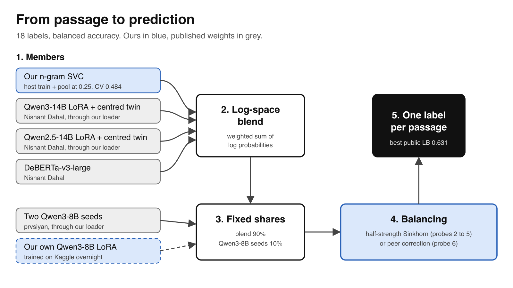
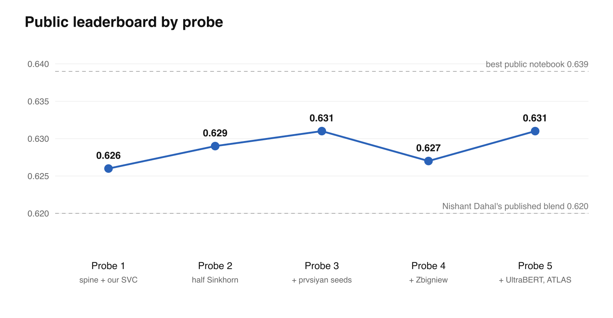

<div align="center">

# Name That LLM

**Which of 18 language models wrote this passage?**

[](LICENSE)
&nbsp;[](https://github.com/Nabzx/name-that-llm/actions/workflows/tests.yml)
&nbsp;[](https://www.kaggle.com/competitions/name-that-llm)
&nbsp;
&nbsp;

</div>

A solo entry to the Imperial Research Arm qualifier, run on Kaggle's [Name That LLM](https://www.kaggle.com/competitions/name-that-llm). Each passage is 40 to 250 words, written by one of 18 frontier models from OpenAI, Google, Anthropic, Qwen, Z.ai and Moonshot. Test prompts never appear in training, and the score is balanced accuracy.

<p align="center"></p>

## Method

1. **Validation first.** Five folds grouped by prompt, frozen in `src/nthl/folds.csv`, so no prompt is in both train and validation.
2. **More data.** A pool of 84,470 passages from 19 public, open-licence datasets, cleaned and de-duplicated.
3. **Our n-gram SVC.** Four TF-IDF views of each passage. Adding the pool took CV from 0.348 to 0.484.
4. **Published checkpoints, our own loader.** LoRA classifiers other Kagglers published on Qwen3 and Qwen2.5, read by code we wrote from scratch, with checks on label order and end token.
5. **Blend and balance.** A weighted sum of log probabilities, fixed shares for extra members, then half-strength Sinkhorn or peer correction.
6. **Our own LoRA.** A two-stage Qwen3-8B classifier trained on Kaggle: the pool first, then host train.

Every change is one row in [`docs/experiments/LOG.md`](docs/experiments/LOG.md). The reasoning sits in [`docs/research/`](docs/research).

<p align="center"></p>

## Reproduce

```bash
python -m venv .venv && .venv/bin/pip install -e ".[dev]" kaggle
.venv/bin/pytest -q                              # unit tests, CPU only
.venv/bin/kaggle auth login                       # your own Kaggle account
scripts/push_src.sh                               # uploads src/nthl as the code dataset
.venv/bin/kaggle kernels push -p notebooks/submit --accelerator NvidiaTeslaT4
```

Nothing is trained on a laptop. Every model is trained and run in a Kaggle notebook under `notebooks/`, with seed 42 and the frozen folds. Each probe is one version of `nabilshah/nthl-submit`, and its settings sit at the top of `notebooks/submit/run.py`. The submission runs offline on two T4s in about 2 hours, inside the 9 hour limit.

## Credits

Published checkpoints, public pools and notebooks we read are listed in [`CITATIONS.md`](CITATIONS.md), with their licences. They keep their own terms. Every AI session used is exported in [`ai-sessions/`](ai-sessions).

## Licence

The code in this repository is [Apache 2.0](LICENSE).
